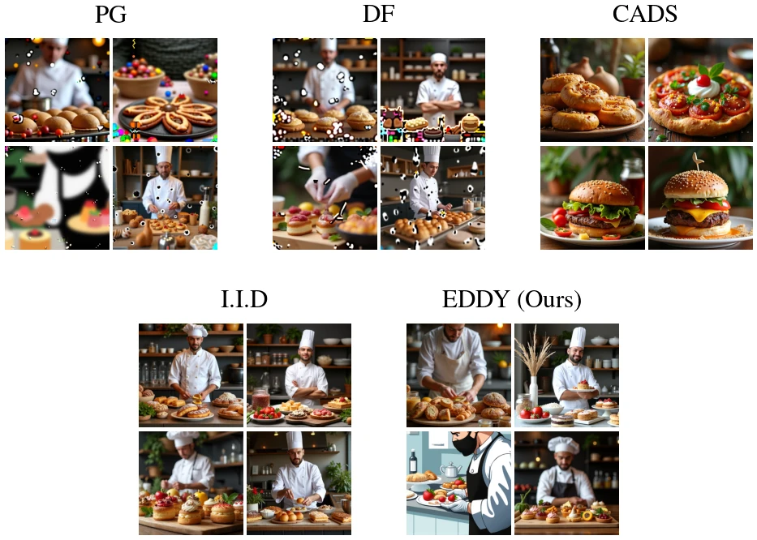

# EDDY

### 🔗 [Project Page](https://galvinograd.github.io/eddy)



Reference implementation of:

> **Diverse Sampling in Diffusion Models with Divergence-Free Particle Guidance**
> Gal Vinograd, Idan Achituve, Ethan Fetaya
> [arXiv:2605.06553](https://arxiv.org/pdf/2605.06553)

## What is EDDY?

EDDY is a training-free particle guidance method for increasing sample
diversity in diffusion / flow-matching models without the artifacts caused by
standard repulsive guidance.

Existing particle guidance methods (PG, DiverseFlow, ...) push particles in a
batch apart using the gradient of a repulsive kernel. Because this gradient is
a plain vector field, it also moves probability mass off the data manifold
even when the batch is already independent — which shows up as visible
artifacts in generated images.

EDDY instead couples particles through **anti-symmetric matrix fields** passed
through a Stein operator. Any such field leaves the Fokker–Planck equation
(and therefore each particle's marginal distribution) invariant, so the
interaction cannot by itself distort the data distribution. Because this also
means EDDY cannot create diversity out of an already-independent batch, it is
paired with a negatively correlated initial noise prior, which keeps each
particle's own marginal exactly Gaussian while coupling the batch.

Since exact second-order kernel terms are expensive for perceptual kernels
(e.g. DINOv2), EDDY approximates them with finite differences and Hutchinson
trace estimation.

## Repository layout

| File | Contents |
|---|---|
| [`alg_eddy.py`](alg_eddy.py) | `EDDYGuidance` — the core per-step guidance computation: kernel gradients, Hutchinson trace estimates, HVP terms via finite differences, and their accumulation into a per-particle guidance vector. |
| [`cb_eddy.py`](cb_eddy.py) | `EDDYCallback` / `EDDYConfig` — a `diffusers` `callback_on_step_end` hook that wires `EDDYGuidance` into the sampler, converting model output to score/velocity per parameterisation (flow-matching vs. epsilon-prediction) and applying the guidance update to the latents. |
| [`embedding.py`](embedding.py) | `VisionExtractor` — decodes diffusion latents to pixels with a tiny VAE (TAEF2 / TAEF1 / TAESDXL) and embeds them with DINOv2 to produce the perceptual features EDDY's kernel operates on. |
| [`logistics.py`](logistics.py) | Dataset (COCO val2017 captions) and output-directory / metadata bookkeeping for generation runs. |
| [`run.py`](run.py) | CLI entry point: builds a `diffusers` pipeline (FLUX.2-klein, FLUX.1-dev, or SDXL), attaches the EDDY callback, and generates images for a batch of prompts. |
| [`test_eddy.py`](test_eddy.py) | Numerical tests checking `EDDYGuidance`'s finite-difference/Hutchinson approximations against closed-form references on synthetic kernels. |

## Usage

```bash
python run.py --model flux2 --diversity mid --num-prompts 100
```

- `--model`: `flux2` (FLUX.2-klein), `flux1` (FLUX.1-dev), or `sdxl` (SDXL base 1.0)
- `--diversity`: `low` / `mid` / `high` (EDDY guidance strength presets), or `iid` to disable EDDY and sample independently
- `--num-prompts`: number of COCO val2017 captions to draw as prompts (downloaded and cached automatically)

Each run draws `VARIANTS_PER_PROMPT` (default 4) images per prompt with a
fixed seed, and writes images plus a `metadata_seed_<seed>.csv` manifest to
`~/<model>/eddy_<diversity>/` (see [`logistics.py`](logistics.py)).

Per-model EDDY hyperparameters (`stop_step_ratio`, `fd_eps`,
`hutchinson_samples`, `gamma`, and per-diversity guidance weight `wg`) are set
in `EDDY_DEFAULTS` / `EDDY_CONFIGS` in [`run.py`](run.py).

## Requirements

CUDA GPU required (pipelines are built with `DEVICE = "cuda"`).

```bash
pip install torch diffusers transformers safetensors accelerate
```

## Citation

```bibtex
@article{vinograd2026eddy,
  title   = {Diverse Sampling in Diffusion Models with Divergence-Free Particle Guidance},
  author  = {Vinograd, Gal and Achituve, Idan and Fetaya, Ethan},
  journal = {arXiv preprint arXiv:2605.06553},
  year    = {2026}
}
```
